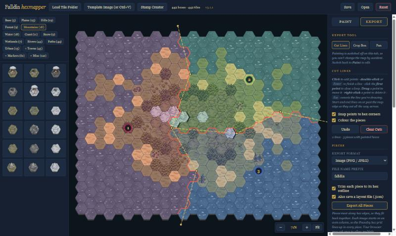

# Falldin hexmapper

A two-tool browser suite for building hex maps from the *World Map Hex Tiles* asset pack:
draw the map, and author reusable multi-hex **stamps** to speed it up.

The tool is compatible with Hex tile assets made by 2minutetabletop 

https://2minutetabletop.com/world-map-hex-tiles-assets/ 
This is the link for the assets. I highly recommend you use the patreaon assets for highest quality.

User notes : the mountain assets need adjustments still . Also any extra assets need to be loaded seperately. You choose which to use at any given moment .

Also the map


| File | What it is |
|---|---|
| `hex-editor.html` | **The map tool** — draw terrain, rivers, features; place stamps; export. |
| `stamp-creator.html` | **The piece creator** — build custom pieces (1 or more hexes, pack tiles or your own art) to reuse in the map tool. |
| `falldin-pieces.js` | Shared stamp/piece format used by the tools. **Keep it in the same folder** as the `.html` files. |
| `README.md` | This file. |

---

## Requirements

- **Google Chrome or Microsoft Edge.** (The folder picker + clipboard paste need a Chromium browser; Firefox/Safari won't load the tile folder.)
- The tile asset pack, e.g. `…\World+Map+Hex+Tiles+-+Patreon+Assets\`.
- No install, no internet. Just double-click an `.html` file.

---

## Quick start

1. Double-click **`hex-editor.html`**.
2. Click **Load Tile Folder** and choose one DPI folder — **`Assets - 72 DPI (VTT)`** is recommended for editing (small & fast).
   - You can also point it at the whole pack root; duplicates across DPI folders are removed automatically and it keeps the 72 DPI copy.
   - The status bar reports what loaded, e.g. `753 tiles · 227 extras · 690 dupes skipped`.
3. Set **Columns / Rows** (a single 500 km map-square ≈ **30 × 26** at 12-mile hexes).
4. Pick a terrain tile from the palette and click/drag on the grid to paint.

That's the loop. Everything below is detail.

---

## The map tool (`hex-editor.html`)

The right panel has two tabs: **Paint** (everything for building the map) and **Export** (everything for getting it out). Painting is switched off on the Export tab so you can't change the map by accident.

### Tools (Paint tab)
- **Paint** – lay the selected tile. Click or drag.
- **Erase** – remove the top item of the active layer. (Right-click erases with any tool.)
- **Fill Area** – draw a freehand loop; every hex inside fills with the selected tile.
- **Stamp** – place a saved stamp (see Stamps below).
- **Pan** – drag to move the view. (Also: middle-mouse drag, or hold **Space** and drag.)
- **Recenter** – click a hex, then drag (or arrow-keys) to nudge an off-centre tile; double-click resets it.

### Layers
Each hex holds three layers, picked with the **Active Layer** buttons:
- **Terrain** – the base tile (one per hex; replaces).
- **River/Path** – stacks on top; supports rotation & auto-connect.
- **Feature** – towns, ruins, banners, etc.; stacks on top.

Picking a tile auto-selects the right layer (a river tile -> River/Path, a town -> Feature).

### Rivers & paths
- Rotate the piece before placing: **`R`** key, **scroll wheel** (while a river/path is active), or the **Rotate −60° / +60°** buttons — 60° steps give all six edge orientations from one asset.
- **Click a placed river again** to rotate it in place.
- **Auto-connect** (on by default): placing an unrotated river drops the matching piece on the neighbouring hex, so flow connects.

### River / Road Brush
Draw rivers and roads as lines instead of placing pieces one by one.
1. Pick **River/Road Brush** (Tool panel) and choose what it draws (**River**, **Dirt Path**, ...).
2. **Drag** across the map. The line snaps to the hexes under it; skipped hexes are filled in, and dragging back over the last hex takes it off again.
3. Let go: every hex gets the river or path piece whose ends meet its neighbours, turned as needed.

- Drawing into an existing river turns that hex into a **junction**. The pack has no single tile for an even three-way "Y", so those are built from two tiles.
- A river that ends **next to water** (ocean, lake, coast) flows into it. Otherwise it starts at a **spring**; hold **Shift** as you let go to end it in a **small lake** instead.
- **Right-drag** (or tick *Brush erases instead*) removes the river or road from those hexes, and the neighbours are re-pieced so nothing is left dangling.
- Rivers and roads are separate, so a road can cross a river. **Ctrl + Z** undoes a whole stroke. **Esc** cancels the stroke you're drawing.
- Which edges each tile connects is read from the tile images when you first use the brush, so it works with any DPI folder.

### Wall & cliff assets: picking and loading
Walls need textures; cliffs don't. Load your walls once and the browser remembers them.

**1. Where wall textures come from**

| Source | Where it is | What you get |
|---|---|---|
| Dungeondraft's built-in walls | `Dungeondraft.pck` in the Dungeondraft install folder (for example `C:\Program Files\Dungeondraft\`) | stone, stone_09, stone_12, concrete, cobble, battlements, wood 1–4. These are white line art, tinted with the colour picker. |
| 2-Minute Tabletop Dungeondraft packs | the `.dungeondraft_pack` files from your 2MT downloads | Painted walls in the same hand-drawn style as the hex tiles. |
| A `Walls and cliffs` folder | anywhere; keeping it inside the tile pack folder works well | The same walls as plain images, one subfolder per pack, plus any walls you make yourself. |

**2. Which walls suit a hex map**
- **City walls / fortifications**: *2MT Medieval Building Map Assets · Wall - Stone A/B - Convex*, *2MT Dungeon Wall and Floor Assets · Wall - Straight - Convex*, or Dungeondraft *battlements* / *stone_09* tinted a warm grey (try `#a39a86`).
- **Low walls, dykes, border walls**: *2MT Medieval · Low*, *2MT Dungeon Wall and Floor · Low Wall - Straight - Flat*, Dungeondraft *concrete* or *stone*.
- **Palisades and wooden forts**: *2MT Medieval · Wall - Wood A/B*, Dungeondraft *wood* … *wood_04* tinted brown.
- **Ruins**: *2M Desert Map Assets · desertruins*.
- Indoor pieces (interior walls, railings, sewer pathways, curbs) and modern ones (Scrap Town fences, barbed wire) also load, but rarely fit a world map.

The **Convex** and **Concave** 2MT walls have a 3D side. If it faces the wrong way, use **Flip piece** or **Flip line** (see the brush modes below).

**3. Loading them** (Wall Brush settings, Paint tab)
- **Load Walls Folder** → pick the `Walls and cliffs` folder (or any folder of wall images). Every subfolder loads in one go.
- **Load Walls** → pick `Dungeondraft.pck` and/or any `.dungeondraft_pack` files. Hold **Ctrl** to select several at once. Only the wall textures are read out of each pack, so even the large Dungeondraft file loads quickly.
- The status line says how many wall styles loaded, and the **Wall brush** dropdown lists them grouped by pack.
- They are remembered in this browser, so next time the dropdown is already filled. Load them again after switching browser or clearing the browser's site data.
- Walls loaded from a pack and from a folder named like that pack get the same names, so maps drawn with either one find their walls.

**4. Making a `Walls and cliffs` folder of your own**
```
Walls and cliffs\
  Walls\
    Dungeondraft\                          stone.png, stone_end.png, stone_09.png ...
    2MT Medieval Building Map Assets\      Wall - Stone A - Convex_wall.webp, ..._wall_end.webp ...
    My walls\                              hedge.png, hedge_end.png
  Cliffs\                                  (skipped by the map tool)
```
- **Subfolder name = pack name** in the dropdown. Name it exactly like the pack (as the dropdown shows it) to keep the same wall names as loading the pack directly.
- **Your own wall image**: a long horizontal strip on a transparent background (PNG or WebP). It must tile left to right without a visible seam, with the wall running along the middle. Empty rows above and below are trimmed automatically.
- **End cap** (optional): an image named `<name>_end` with the same height, drawn as the *right-hand* end of the wall. It is mirrored for the left end.
- **Load Tile Folder** always skips a folder called `Walls and cliffs`, so it can live inside the tile pack without its strips showing up as tiles.

**5. Cliffs**
Nothing to load. The rocky, grassy and snowy cliffs (and sandy, if the pack has a desert base) are built from the hex tiles each time you load the **tile folder**, so they match whichever DPI and pack you use. Without a tile folder they fall back to flat colours. Any images in a `Cliffs` subfolder are only copies for other programs; the map tool ignores them.

**Troubleshooting**
- *"No wall textures found"*: that file has no walls (many packs only hold objects or floors).
- *Walls look like plain grey bands after opening a map*: that map uses a wall style this browser hasn't loaded. Load the pack or folder named in the message.
- *The wall is too thin or thick*: city walls look right at about **6–10%** thickness, big fortifications at **12–20%**. Cliffs default to a height of **20%**.

### Wall Brush
Draw walls along the hex **edges** (city walls, border walls, palisades).
1. Pick **Wall Brush** (Tool panel).
2. Load wall textures (see *Wall & cliff assets* above). Any of these work:
   - **`Dungeondraft.pck`** from your Dungeondraft install folder, for the built-in walls (stone, stone_09, concrete, battlements, wood...);
   - any **`.dungeondraft_pack`**, for example the 2-Minute Tabletop *Medieval Building* or *Dungeon Wall and Floor* packs, whose walls match the hex tiles' hand-drawn style;
   - plain wall images (`name.png`, with an optional `name_end.png` end cap);
   - **Load Walls Folder**: a folder of such images, one subfolder per pack (for example a `Walls and cliffs` folder kept in the tile pack). Each wall is named after its subfolder, so a subfolder named like the pack gives the same wall names as loading the pack itself. **Load Tile Folder** skips any `Walls and cliffs` folder, so the wall strips never end up in the tile palette.

   The textures are read straight from the pack and remembered in this browser, so each pack only needs loading once. Nothing is copied next to the tool.
3. Choose a style, colour and thickness, then **drag** along the hex edges. Corners join up neatly, and loose ends get the wall's end cap.

- **Click** an edge to add or remove a single wall. **Right-drag** (or tick *Wall brush erases instead*) removes walls.
- **Colour**: white keeps a texture's own colours; any other colour tints it (the Dungeondraft built-in walls are white line art meant to be tinted). **Plain (colour only)** needs no textures.
- Walls are saved in the map file, by style name. Open a map before its wall pack is loaded and its walls are drawn plain until you load it.
- **Ctrl + Z** undoes a stroke, **Esc** cancels the stroke you're drawing. Walls show up in every export, HD render and cut piece.

### Cliff Brush
Draw cliffs and escarpments along hex edges, the same way as walls.
- Styles: **rocky**, **grassy** and **snowy** (plus **sandy** if your tiles include a desert base). They are built from the loaded tile pack: the colours come from the *Base* tiles and the rock detail from *Mountains, medium (rocky)*, so they match whatever pack is loaded. No extra files are needed.
- **Drag** along the edges. The ground drops on the **right** of the direction you drag; ticks on the stroke show the low side. Tick **Drop to the left of the stroke** to flip it. Tip: drag *anticlockwise* around a plateau to make it stand up.
- **Click** an edge to add or remove one piece; the side you click on is the high side. **Right-drag** erases.
- Each cliff casts a soft shadow onto the low ground, and loose ends taper off instead of stopping square. **Cliff height** sets how wide the rock face is.

### Wall & cliff brush modes
The **Draw · Flip piece · Flip line · Surround · Delete piece · Delete line** buttons (above the Wall brush settings) work with both the Wall Brush and the Cliff Brush.
- **Draw**: drag and click as described above.
- **Flip piece**: click a wall or cliff to turn that one piece the other way round. A cliff swaps its high and low side; a wall turns its 3D face (and end caps) to the other side. The piece under the cursor is highlighted in blue.
- **Flip line**: the same, for every piece connected to the one you click (all connected walls, or all connected cliffs).
- **Delete piece** / **Delete line**: click a wall or cliff to remove that one piece, or the whole line connected to it. What will go is highlighted in red first; **Ctrl + Z** brings it back.
- **Surround**: click a hex and its whole connected area of that tile type (variants such as *Plains (lush) 1–5* count as one type) is ringed with the current wall or cliff. With the Cliff Brush the area becomes **raised**: high inside, dropping outward. Hover to see the ring before you click.
  - **Shift + click** rings *every* area of that tile type on the map.
  - Tick **Surround: the clicked area is the low ground** to make a basin or canyon floor instead.
  - **Right-click** removes the ring around that area. No ring is drawn along the map's own edge.
  - One **Ctrl + Z** undoes a whole surround or flip.

### Handy extras
- **Native asset size** (Grid panel, on for new maps): towns, banners and other extras keep their true size next to the terrain instead of stretching across the hex, matching the Stamp Creator. Maps saved before v3.2 open with it off so they look the same as before.
- **Alt + click** = eyedropper (copy a hex's terrain onto your brush).
- **Randomize terrain variant** (on): painting Plains/Forest/etc. auto-varies so large areas don't look tiled.
- **Ctrl + Z** = undo (diff-based; cheap even on big maps).
- **Ruler** toggle shows column/row numbers.

### View & performance
- **Zoom**: on-screen `−  %  +` widget, **Ctrl + scroll** (zooms to cursor), or **`0`** to fit the whole map.
- Only on-screen hexes are drawn, and when zoomed far out it swaps to a fast colour overview — so large maps (100×100+) stay smooth.

### Template underlay
- **Template Image (or Ctrl+V)** — load or paste a reference map to trace over. Sliders control opacity / scale / offset; a checkbox draws it on top instead.

### Saving
- **Save / Open** – project files (`.json`, dictionary-compressed).
- **Save States** panel – quick named saves kept *in the browser*, plus **auto-save** that offers to restore on reload.
- **Reset** – wipes the map (double-confirmed).

### Exporting (Export tab)
- **Export Tool** – **Cut Lines**, **Crop Box** (drag a box to select a region; shows its size in hexes) and **Pan**.
- **Export Whole Map Image** – the whole map as a flat image (auto-scales down if huge).
- Whole Map / Crop Box panel:
  - **Export Selection** – just the cropped region.
  - **Render Selection in HD** – the cropped region at **full asset resolution**. *This is the best way to get a poster-quality regional map.*
  - **Crop Map to Selection** – trim the working map down to the box.
- **Output Settings** – resolution (px per hex) and JPEG toggle, shared by the exports.

### Cutting the map into pieces
Split a big map into smaller pieces that fit back together, for example one Foundry scene per region.



1. On the **Export** tab pick **Cut Lines**.
2. **Click** to add points along the line you want; **double-click** or **Enter** finishes it. Lines can bend wherever you like. Click the line's **first point** to close it into a loop (cuts out an island or region).
3. **Drag** a point to move it, **right-click** a point to delete it, **Esc** cancels the line you're drawing, **Ctrl + Z** undoes cut edits on this tab.
4. Start and end lines on or past the map edge; ends that stop close to the edge are pulled out past it automatically.

Each hex goes to the side of the cut its centre falls on, so the pieces always meet along real hex edges (shown as a red outline, with each piece tinted and numbered). The **Pieces** panel lists every piece that has painted hexes.

**Export All Pieces** (or a piece's own **Export** button) saves each piece in the chosen format:
- **Image (PNG / JPEG)** – transparent outside the piece.
- **HD image** – at full HD-asset resolution (load the HD tile folder first).
- **Foundry scene JSON + image** – one ready-to-import scene per piece.
- **.dd2vtt** – one Universal Battlemap Import file per piece.

Options: **Trim each piece to its hex outline** (on by default: neighbouring pieces fit edge to edge with no overlap) and **Also save a layout file** (`<prefix>-layout.json`, which records each piece's hex range and where its image sits in the full map). Every piece image starts on an even column, so the Foundry hex grid lines up in every piece. Cut lines are saved with the project.

**High-res workflow:**
1. Load the **HD tile folder** into the HD slot (**Load HD Tile Folder** in the *Render (High-Res)* panel).
   - Use **`Assets - 300 DPI (Print)`** — note it's **WebP**, which the tool now accepts.
2. **Crop Box** a region (Export tab).
3. **Render Selection in HD** -> saves `falldin-region-hd.png`.
   A whole-map HD render must scale down to fit the browser; a *cropped* region usually renders at true full resolution.

---

## The piece creator (`stamp-creator.html`)

Build **pieces** (stamps) that cover one or more hexes, fit the hex grid exactly, and can be reused in any map.

### 1. Shape
- Every piece has a **middle hex**, shown as a gold ring. When you place the piece on the map, the middle sits under your cursor, and turning the piece (R) turns it around the middle. **Set Middle** moves it: click any hex.
- **Size around the middle** grows the piece in rings around the middle: 1 = just the middle hex, 2 = up to 7 hexes, 3 = up to 19, and so on. Moving the slider rebuilds the shape around the middle. Hexes beyond the new size are dropped, and Ctrl+Z brings them back.
- **Shape** tool: after picking a size, click or drag single hexes in and out of the piece. Painting a hex adds it to the piece too.
- A piece hex can be left empty: it still counts as part of the piece's shape.

### 2. Fill
- **Load Tile Folder / Add Files** loads pack tiles plus every Extra (towns, banners...). Loading is additive.
- Paint with the same three layers as the map tool: **Terrain**, **River/Path**, **Feature**.
- **Import Image** adds your own art (a PNG with transparency works best) to the active layer. It is fitted to the piece's shape automatically, and a multi-hex image starts **trimmed to the hex outline**, so it fits the grid exactly. **Fit to Shape** and the **Trim** checkbox are in the Selected panel.

### 3. Adjust and check the fit
- **Select / Adjust**: click anything in the piece. **Drag** moves, **scroll** resizes, **R** rotates 15°, arrow keys nudge, **Del** deletes, double-click resets. Sliders set size, rotation, hue, saturation and opacity; Flip / Front / Back are buttons.
- **Show surroundings** draws terrain around the piece so you can judge how it meets the map. **Use selected palette tile around the piece** changes which terrain.

### 4. Save
- **Save to Library** saves the piece; it appears in the map tool's Stamps panel.
- Click a library thumbnail to edit that piece again. Saving with the **same name** updates it; a **new name** saves a copy and leaves the original.
- **Export File** / **Export Whole Library** save `.json` files to share. **Import** loads them back into the library.

Pack tiles are stored by name, so an HD render uses the HD tiles. Your own images are stored inside the piece (and inside map files that use them), so one file is enough to share it.

**Your images in HD renders.** Pack tiles are swapped for their HD copies, but your own images are drawn from the pixels you imported. The Selected panel shows each image's **detail in px per hex**. For sharp results, aim for the hex width of the render you plan to make: about **224 px** per hex for 72 DPI, **466** for 150 DPI and **930** for 300 DPI. For example, a city spanning 3 hexes wants an image about 2800 px wide for 300 DPI. Imported images are capped at 4096 px on their longest side, which covers about 4 hexes at full 300 DPI detail. The map tool's HD render also tells you when one of your images is less detailed than the render.

### The library folder
Click **Choose Folder** (Library panel in the piece creator, or **Library Folder** in the map tool's Stamps panel) and pick a folder, for example `Documents\Falldin pieces`. From then on:
- every piece is a file in that folder, named after the piece (`walled-city.stamp.json`);
- both tools read the same folder, and the map tool picks up new pieces when you switch back to it (or press **Reload**);
- you can sort pieces into **subfolders**, copy the folder to another computer, or put it in Dropbox / OneDrive. A `.pack.json` dropped in the folder shows its pieces too (read-only);
- the folder is remembered. After a browser restart, Chrome may ask again: click **Allow Access to Folder**.

When you first choose a folder, the creator offers to copy pieces you saved in the browser before into it. Until you choose one, pieces are kept in browser storage, which is small: pieces with your own images fill it quickly.

### Using stamps in the map tool
Open **hex-editor.html** -> **Stamps** panel -> click a piece -> click the map to place it. **Import file** adds a `.stamp.json` or pack to the library.

While placing, a see-through **preview** of the piece follows the cursor, outlined in gold (red where it would hang off the map edge).
- **R** turns it 60° clockwise, **Shift + R** back; **M** mirrors it left-right. The buttons under the Stamps panel do the same.
- Rivers and paths turn with the piece, so they still meet the same hex edges. Your own images that are trimmed to the piece's outline turn too, so they still fit it.
- Terrain, towns and other features stay upright, so nothing is drawn on its side. Mirroring flips everything.
- The turn is kept while you place more copies.

A placed piece keeps every adjustment made in the piece creator (nudge, size, rotation, flip, colour, opacity), and lands with the same shape on any hex.

Stamps store **tile names**, not pixels — so a placed stamp becomes ordinary map cells and
**automatically renders at full resolution** in an HD render.

---

## Keyboard & mouse reference

| Action | Input |
|---|---|
| Paint / place | Left-click or drag |
| Erase | Right-click, or the Erase tool |
| Eyedropper | **Alt** + click |
| Rotate river/path | **R** (Shift+R reverse) · scroll · click a placed river |
| Draw / erase a river or road | River/Road Brush: drag · right-drag · Shift on release = lake end |
| Draw / erase a wall | Wall Brush: drag along edges · click an edge · right-drag |
| Draw / erase a cliff | Cliff Brush: drag (drops to the right) · click the high side of an edge · right-drag |
| Turn / mirror a piece while placing | **R** (Shift+R reverse) · **M** |
| Undo | **Ctrl + Z** |
| Pan | Pan tool · middle-drag · **Space** + drag · scroll |
| Zoom | Ctrl + scroll (to cursor) · `−`/`+` · **`0`** = fit |
| Paste template | **Ctrl + V** |

---

## Scale cheat-sheet (for D&D)
Note that these measurements are from my own design. If you want you can downscale or upscale this to your own desires.

- **1 hex = 12 miles ≈ 19.3 km**; one 500 km map-square ≈ **30 columns × 26 rows**.
- Travel at Normal pace (24 mi/day) = **2 hexes/day**.

---

## Notes & caveats

- **Chromium only** — the folder picker is a Chrome/Edge feature.
- **Map files from v3.2 use a new format (v4).** Older map files still open in v3.2, but v3.2 maps don't open in older versions of the tool, or in the Godot port yet.
- **Choose a library folder** for your pieces. Without one they live in the browser's local storage for the folder you run the tools from, which is small and easy to lose.
- **300 DPI is WebP.** Both loading and HD render handle it, but if an HD render says "tiles not found", (re)load the 300 DPI folder into the HD slot first.
- **Extended assets are kept** — they're different tiles, not duplicates. Only same-name copies across DPI folders (and a stray `Extras - Copy` folder) are de-duplicated.
- Everything runs locally; nothing is uploaded anywhere.
