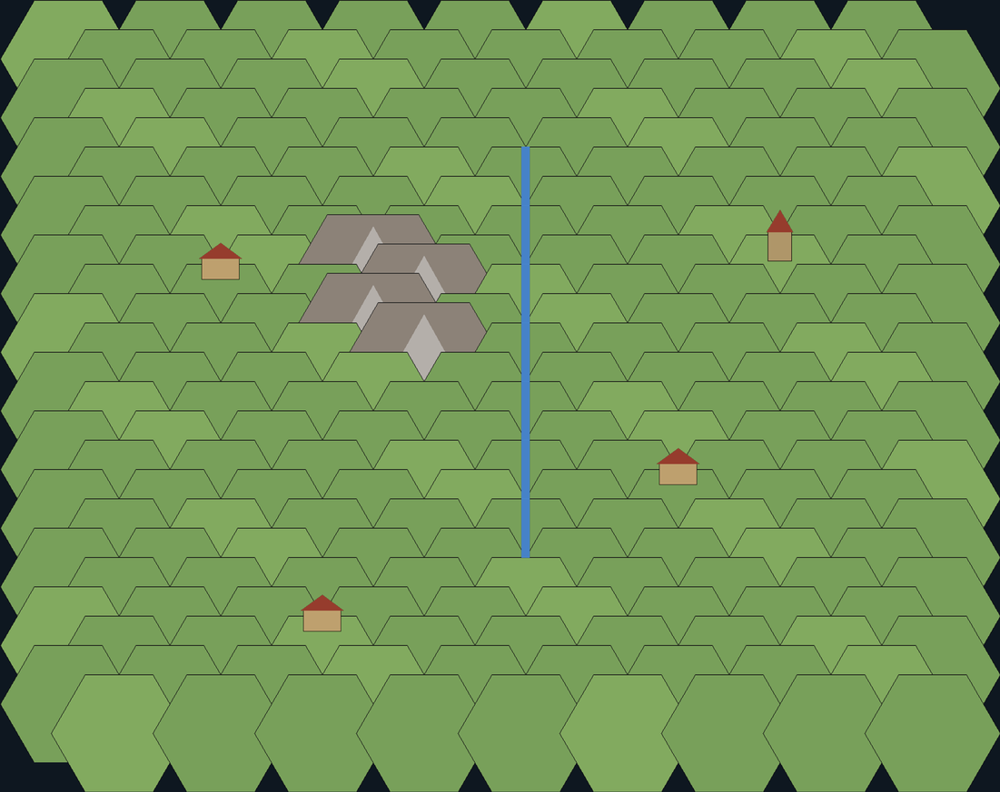

# Falldin

A hex map editor for the *World Map Hex Tiles* pack, written in Godot.

Requires Godot 4.4 or newer. Developed against 4.4, and the full test suite is
verified on 4.7.2 with no source changes.

This is a port of a three-tool browser suite that drew maps of the Falldin
setting. The browser version works and is still the place to author tokens and
stamps; this one exists because of the things a canvas element cannot do.



---

## Why a port

Not because JavaScript is the wrong language. Because of four specific walls:

| Wall | In the browser | Here |
|---|---|---|
| Render size | ~120 megapixels, 16 384 px a side | limited only by memory; 25 000 px verified in the test suite |
| Asset resolution | one DPI loaded at a time, with a separate "HD slot" for print | every DPI indexed under one name, chosen per draw |
| Storage | a few MB of `localStorage`, silently trimmed | ordinary files |
| Automation | none; every render is a click | `--headless` batch rendering from a shell |

Everything the browser tools saved still opens: projects in all four of their
formats, `.ftok` tokens, `.stamp.json` stamps.

---

## Running it

1. Get [Godot](https://godotengine.org/download) — one executable, no installer.
2. Open `project.godot`, press **F5**.
3. **Load Assets…** and point it at the tile pack. Point it at the pack root and
   every DPI is indexed at once; there is no separate HD folder to remember.
4. **Import browser map…** to open a `falldin-hexmap.json`, or **Open…** for a
   native `.falldin`.

### Rendering without opening anything

Windows:

```bat
"C:\path\to\Godot_v4.7.2-stable_win64.exe" --headless --path . ^
    --script res://tools/render_cli.gd -- ^
    --assets "D:\World+Map+Hex+Tiles+-+Patreon+Assets" ^
    --map    aska-north.falldin ^
    --out    aska-north.png ^
    --ppx    933
```

macOS and Linux:

```sh
godot --headless --path . --script res://tools/render_cli.gd -- \
    --assets "…/World+Map+Hex+Tiles+-+Patreon+Assets" \
    --map    aska-north.falldin \
    --out    aska-north.png \
    --ppx    933
```

`--ppx` is pixels per hex; leave it out and it uses the pack's own resolution,
which is what "full resolution" means for this art. `--region c0,r0,c1,r1`
renders one block of hexes. `--help` lists the rest.

The console build of Godot (`Godot_…_console.exe`) prints to the terminal on
Windows; the plain one detaches, so use the console build for the CLI.

### Tests

Windows — set `GODOT` and double-click `run_tests.bat`, or from a prompt:

```bat
set GODOT=C:\path\to\Godot_v4.7.2-stable_win64.exe
run_tests.bat
```

macOS and Linux:

```sh
GODOT=/path/to/godot ./run_tests.sh
```

201 assertions: 160 across the core, 41 driving the real interface with no
window attached. They run in about twenty seconds and exit non-zero on failure.

---

## How it is put together

```
src/core/     no Godot nodes, no UI, no I/O beyond files — all of it testable headlessly
  hex.gd              flat-top odd-q maths, offset <-> cube conversion
  asset_library.gd    folder scan, DPI indexing, categories, native sizing
  piece.gd            one drawn asset and its transform
  token.gd            .ftok read/write
  token_instance.gd   a token placed on a map
  map_document.gd     cells, tokens, undo
  draw_list.gd        document -> ordered draw commands
  legacy_io.gd        readers for every browser format
  stamp.gd            .stamp.json, parity-corrected
  project_io.gd       the native .falldin format
  exporter.gd         CPU image compositing
src/app/      everything that needs a screen
  map_view.gd         the canvas and its tools
  main.gd             the shell, built in code so it diffs and tests cleanly
tools/render_cli.gd   headless batch rendering
tests/                two suites and a small harness
```

### One measurement, everywhere

Every length in the core is in **hex widths**. One hex is `1.0` across and
`194/224` tall. Pixels appear once, at the end, when a view multiplies by its
zoom or an export by its resolution.

This is why the same document draws at 64 px per hex on screen and 933 px per
hex in a print render with no number changing, and why a nudged tile stays put
when you zoom. The browser version mixed pixels and ratios and paid for it: a
nudge drifted at a different zoom, and the print render had its own copy of the
offset maths that had to be kept in step by hand.

### One painter, three consumers

`DrawList.build()` turns a document into a flat, ordered list of "draw this
texture, here, this big, at this angle". The screen view, the image exporter and
the CLI all walk that same list.

The old tools each had their own drawing loop, which is how a fix to the screen
never reached the print render. Here there is nowhere for them to disagree.

### Three passes, not one per hex

Tiles are drawn about twice as wide as their hex so the art bleeds over the
edges. Painting each hex complete — ground, river, town — before starting the
next one meant the next hex's ground landed on top of the previous hex's town.

`DrawList` lays **all** the ground, then **all** the water, then **all** the
features. A test paints a town with ground on the hex below it and looks for the
roof's colour in the rendered pixels.

### Assets at the size they were drawn

A 96 px town beside a 224 px hex tile is 43 % of a hex. Drawing it any other
size is a guess, and stretching it to fill a hex is what made towns dwarf the
terrain around them.

`AssetLibrary` measures one plain hex tile and treats it as the yardstick, so an
oversized mountain tile overhangs its hex on its own and a narrow tower stays
narrow. Aspect ratios come from the art, never from the hex.

### Every transform on the piece

Size, offset, rotation, flip, hue, saturation and opacity belong to the
individual piece. That is the difference between shrinking the town and
shrinking the town, the grass and the river with it.

Sizes are absolute widths rather than multipliers, so a piece keeps its size
when the asset pack changes or a slider moves.

---

## Two bugs the port found

Porting code is a good way to read it.

**Rivers never auto-connected.** The browser split `"Hex - River 1 N"` into a
prefix and a direction, but dropped the space between them, then looked for
`"Hex - River 1" + "S"`. That name does not exist, so the matching half was
never placed and the feature quietly did nothing. Fixed here, and the fix is
covered by a test.

**Stamps changed shape depending on where you dropped them.** Offsets were
stored as raw distances from whichever hex was top-left when the stamp was
saved. Odd columns sit half a row lower than even ones, so a stamp authored
against an even column came out skewed on an odd one. Stamps now resolve to cube
coordinates on load, which have no such seam, and land as the same shape
wherever they go.

---

## What is here and what is not

**Working:** asset loading, painting, erasing, the three layers, auto-connecting
rivers, per-piece transforms, placing and arranging tokens (Shift+click stacks
another on an occupied hex), crop selection, undo, the native format, import of
every browser format, PNG export, headless rendering.

**Not yet ported:** authoring tokens and stamps. `token-maker.html` and
`stamp-creator.html` still do that, and what they write loads here unchanged.
The Foundry scene and `.dd2vtt` exports are also still browser-side.

**Not verified:** anything that needs a screen. This was built in a container
with no GPU, so the core and the interface's wiring are tested on both 4.4 and
4.7.2, but nothing was ever actually drawn to a window. Expect to shake out
layout on first run.

---

## Keys

| | |
|---|---|
| Pan | middle-drag, **Space**+drag, or the Pan tool |
| Zoom | scroll, **Ctrl**+scroll, **0** to fit |
| Rotate brush | **R** (**Shift+R** back) |
| Undo | **Ctrl+Z** |
| Nudge selection | arrows (**Shift** for a bigger step) |
| Resize selection | scroll with the Move/Size or Token tool |
| Stack a token on an occupied hex | **Shift**+click |
| Delete a token | **Del**, or right-click it |

---

## Scale

1 hex = 12 miles ≈ 19.3 km. A 500 km map square is about 30 × 26 hexes.
Travel at a normal pace, 24 miles a day, is 2 hexes a day.
